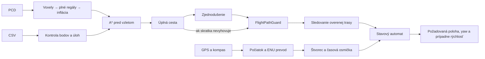
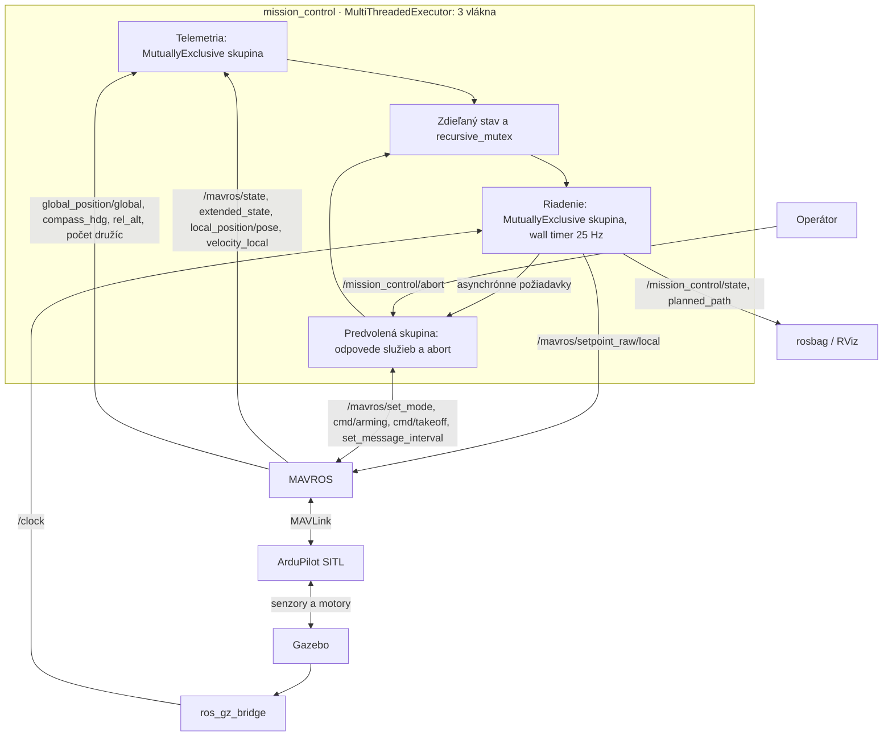

# Návrh riešenia – plánovanie a autonómny let

Balík `lrs_assignment1` rieši spracovanie mapy a plánovanie (A1.1), let podľa CSV
misie v hangári (A1.2) a vonkajší let so štvorcom a osmičkou (A1.3). Vnútorná
misia používa mapu; vonkajšia generuje geometriu vzhľadom na polohu zachytenú pri
štarte. Obe používajú rovnaký uzol `mission_control`, spúšťaný programom
`mission_node`. Táto dokumentácia pokrýva rozhodnutia požadované v A1.4;
[README](../README.md) obsahuje kompletné spúšťanie a [overenie](validation.md)
uvádza merania, záznamy aj zostávajúce obmedzenia.

## 1. Mapa a bezpečnostná rezerva

**Reprezentácia mapy.** PCL načíta PCD a určí jeho ohraničujúci kváder. Pravidelná
3D mriežka má rozlíšenie **0,25 m**; obsadené a rozšírené bunky sa ukladajú ako
množiny celočíselných indexov. Mapa hangára obsahuje 620 311 bodov, 101 616 buniek
a 24 293 obsadených buniek vrátane vyplnených regálov. Priestor mimo mapy je
blokovaný.

Pravidelná mriežka umožňuje jednoduché susednosti a predvídateľný výpočet.
Štvrťmetrový voxel je kompromis medzi zachovaním priechodov a veľkosťou
prehľadávania. Octree by lepšie šetril pamäť pri rozľahlom riedkom priestore,
ale komplikoval by susednosti; pre tento malý hangár nie je potrebný. Hrubšia
mriežka môže uzatvoriť priechod, jemnejšia zvyšuje pamäť aj čas. Neobsadený voxel
tu znamená voľný priestor, preto presnosť výsledku závisí od úplnosti PCD.

**Inflácia.** Pri letovej misii je `safety_radius = 0.65 m`; samostatné príklady
plánovača používajú aj 0,5 m. K obsadenému voxelu sa pridajú susedia, ktorých
vzdialenosť stredov neprekračuje polomer. Ide o diskrétnu aproximáciu rezervy,
nie presné modelovanie obrysu dronu. Hodnota 0,65 m vychádza z pracovného rozpočtu
približne 0,25 m polomeru dronu, 0,18 m tolerancie príletu a 0,22 m dodatočnej
rezervy. Nie je to experimentálne potvrdená horná hranica chyby letu.

Regály sa doplnia dvoma plnými kvádrami do výšky 3,76 m; ulička medzi radmi
zostane zachovaná. Tým sa zakáže let medzi policami aj tam, kde PCD obsahuje
medzery. Samotná veľká inflácia by medzery síce vyplnila, ale zbytočne by zúžila
aj uličky. Nevýhodou kvádrov sú rozmery viazané na daný hangár. Plánovač môže
regál obletieť aj ponad neho, ak je nad ním voľný priestor po inflácii. Výška
riadku CSV je cieľová výška, nie strop celej trasy.

## 2. Plánovanie a úprava trasy

**A\*.** Každý voxel má najviac 26 susedov. Cena kroku je euklidovská vzdialenosť
stredov, teda 0,25 m, √2 · 0,25 m alebo √3 · 0,25 m. Priorita je `f = g + h`,
kde `g` je doterajšia dĺžka a `h` priama euklidovská vzdialenosť k cieľu.
Priama vzdialenosť neprevyšuje dĺžku žiadnej prípustnej obchádzky; heuristika je
prípustná aj konzistentná. Diagonálny krok kontroluje aj bunky pri hrane či rohu,
aby nepreťal blokovanú susednú bunku.

A\* hľadá najkratšiu cestu **v takto definovanom diskrétnom grafe**. Táto vlastnosť
neznamená najkratšiu spojitú krivku ani optimálny čas letu. Náhrada
stredov koncových voxelov presnými bodmi, zjednodušenie a dynamika dronu už nie
sú súčasťou tohto dôkazu. Dijkstra by prehľadal viac buniek bez smerovania
heuristikou; RRT by bol vhodnejší vo veľkom spojitom priestore, ale priniesol by
náhodnosť a potrebu ďalšieho ladenia. Ak otvorená množina ostane prázdna,
plánovač vráti informáciu, že cesta neexistuje.

**Zjednodušenie.** Postup `line-of-sight` preskakuje čo najviac bodov, ktoré sa
dajú spojiť úsečkou. Oproti odstraňovaniu iba kolineárnych bodov skracuje aj
schodovitú trasu. Nepoužíva spline: jeho hladkosť by pomohla riadeniu, ale bolo
by potrebné preveriť celý priebeh krivky pri prekážkach.

| Trasa pri polomere 0,65 m | Body A\* → návrh po zjednodušení | Čas A\* |
|---|---:|---:|
| `(13; 7; 1)` → `(8,65; 2,02; 1)` | 21 → 2 | 1,085 ms |
| `(8,65; 2,02; 1)` → `(4,84; 5,37; 2)` | 21 → 3 | 3,784 ms |

V 24 skúškach dvoch CSV misií pri polomeroch 0,5 a 0,65 m trvalo A\* 0,961–31,995 ms.
Ide o merania samostatného plánovača bez načítania mapy; zaťaženie počítača
výsledky mení. [Podrobné údaje](a11_mission_results.json).

Vzorkovanie úsečky v plánovači po 1/4 voxelu má známu chybu: môže preskočiť
veľmi krátky prienik do blokovanej bunky. Preto A1.2 používa samostatný
`FlightPathGuard`, ktorý rozdelí úsečku pri každom prekročení voxelovej steny
a preverí intervaly aj susedné bunky pri dotyku hrany či rohu. Ak zjednodušenie
nevyhovuje, preverí a použije úplnú cestu A\*. Ak nevyhovuje ani tá, let sa
nespustí. Konzervatívna kontrola môže odmietnuť aj hraničný dotyk. Presné
koncové body sa dopĺňajú pred kontrolou. [Audit a reprodukcia](a11_validation.md).

## 3. Vykonanie misie a natočenie

**Riadenie polohy.** CSV parser overuje konečné čísla, presnosť `hard`/`soft`
a povolené úlohy. Všetky úseky sa plánujú ešte pred aktiváciou motorov. Stavový
automat potom prejde cez `SET_MODE → ARM → TAKEOFF`, navigáciu a úlohy až po
`LAND → DONE`. Odpovede služieb sa kontrolujú; samotné odoslanie príkazu
neznamená, že bol vykonaný. Pri `landtakeoff` sa čaká na zem a deaktiváciu
motorov, po 3 s sa zopakuje nastavenie režimu, aktivácia a vzlet.

| Parameter | Hodnota | Význam |
|---|---:|---|
| `hard_tolerance` | 0,18 m | Presný prílet a úlohy |
| `soft_tolerance` | 0,40 m | Prielet bežným cieľovým bodom |
| `path_tolerance` | 0,35 m | Prielet medzibodom plánovanej trasy |
| `settle_speed`, `settle_seconds` | 0,15 m/s; 1 s | Podmienka ustálenia |
| `navigation_speed` | 0,60 m/s | Rýchlosť posunu požadovanej polohy |
| `yaw_tolerance`, `yaw_hold_seconds` | približne 5°; 2 s | Natočenie a podržanie úlohy |

Hard prílet vyžaduje súčasne malú vzdialenosť aj rýchlosť počas celej doby
ustálenia. Soft bod bez úlohy nevyžaduje zastavenie; úloha si vynúti ustálenie
aj pri označení `soft`. Voľby tolerancií dávajú hard bodu prísnejšie kritérium
než rozmer bunky a soft bodu priestor na plynulý prielet. Príliš malé tolerancie
by spôsobovali dlhé čakanie pri šume; veľké by znižovali presnosť.

Pri presune uzol posúva požadovanú polohu a využíva bezpečný výhľad cez ďalšie
vrcholy trasy. Každé preskočené spojenie overí guardom. Tak nemusí zastaviť
v každom voxeli, hoci výrazná zmena smeru môže vyžadovať stav `ALIGN`.
ArduPilot uzatvára polohové a stabilizačné slučky; balík neimplementuje vlastný
PID. Výhodou je jednoduché rozhranie, nevýhodou závislosť od nastavenia
autopilota a oneskorenie pri sledovaní pohyblivej polohovej požiadavky.

**Smer letu.** Indoor smer je `atan2(dy, dx)` k zvolenému bodu. Úloha `yaw180`
nastavuje absolútny smer 180° v mape, nejde o relatívne otočenie. Po úlohe sa
obnoví smer ďalšieho presunu. Funkcia `unwrap` pripočíta k predchádzajúcemu uhlu
najmenší ekvivalentný rozdiel; skok z +179° na −179° tak znamená +2°. Posiela
sa yaw, nie yaw rate: priamo vyjadruje požadovanú orientáciu a nevyžaduje
integráciu, jeho fyzické sledovanie však závisí od regulátora autopilota.

## 4. GPS, súradnice a vonkajšia geometria

**Geodetický prevod.** Po platnom GPS a aspoň 8 družiciach počas 3 s sa zachytený
fix spáruje s lokálnou polohou EKF. Pôvod misie preto nie je pevná
zemepisná súradnica. Pre šírku φ a dĺžku λ sa používajú lokálne polomery
krivosti WGS84 `M` a `N` v počiatku:

```text
E = N · cos(φ₀) · (λ − λ₀)
N_local = M · (φ − φ₀)
U = h − h₀                         uhly v radiánoch
```

Spätný prevod používa tie isté mierky. Rohy štvorca sa vytvoria z lokálnych
offsetov ako zemepisné súradnice a prevedú späť do ENU. Aproximácia je vhodná
pre malé ihrisko a jednoduchšia než všeobecná projekcia či GeographicLib.
Oproti nezávislému ECEF→ENU výpočtu bola najväčšia odchýlka **2,04 mm**
v testovaných bodoch do 50 m, pri šírkach 0°, 48,15° a 80°. Nie je to globálna
záruka; blízko pólov metóda degraduje a počiatky nad |85°| odmieta.

**Konvencie a výška.** ENU znamená východ, sever, hore; yaw je proti smeru
hodinových ručičiek od východu. Kompas má nulu na severe a kladný smer opačne:
`yaw_ENU = π/2 − heading`. Pred štartom sa porovná s yaw z orientácie dronu;
rozdiel nad 0,35 rad zabráni aktivácii. V celom zázname finálnej outdoor misie
bol RMS rozdiel týchto uhlov 0,0053°. Pri reálnom kompase treba overiť aj
kalibráciu a referenciu severu, samotný prevod znamienka to nevyrieši.

Všetky polia lokálneho ROS setpointu sú ENU. MAVROS ich prekladá do MAVLink NED
aj pri enum hodnote `FRAME_LOCAL_NED`; ručný druhý prevod by trasu pokazil.
Indoor mapa používa posun `(13; 7; 0)` a rotáciu +π/2 voči lokálnemu rámcu.
Vzletová požiadavka je home-relative; letový cieľ má lokálne Z o 5 m vyššie než
zachytený štart a overuje sa aj `rel_alt`. GPS výška sa používa v geodetickom
prevode, nenahrádza relatívnu výšku. Jej výškový dátum závisí od prijímača
a spracovania MAVROS; nedá sa bez overenia zameniť za lokálne Z.

**Štvorec a osmička.** Štvorec má stranu 5 m, výšku 5 m a stred v POI.
`poi_east = poi_north = 0` umiestňuje POI na štart. Každý cyklus sa z aktuálnej
polohy prepočíta vodorovný smer na POI. Riadi sa yaw, nie náklon kamery.
Pred osmičkou dron príde nad stred a natočí sa na začiatočnú dotyčnicu.

```text
θ = ω · (čas − začiatok)
x = x_POI + A · sin θ          vx = A · ω · cos θ
y = y_POI + A · sin θ · cos θ  vy = A · ω · cos 2θ
z = z_štart + 5 m             yaw = atan2(vy, vx)
```

Geronova osmička vzniká priebežným výpočtom, nie CSV bodmi. Poloha aj analytická
rýchlosť sa posielajú autopilotu; rýchlostný predstih znižuje oneskorenie oproti
samotnej polohe. Amplitúda **A = 3 m** dáva rozmery **6 × 3 m**.
Voľba **ω = 0,2 rad/s** znamená obeh 31,42 s simulačného času a maximum
`Aω√2 = 0,849 m/s`. Je pomalšia než limit 1,5 m/s a dáva väčšiu rezervu
na sledovanie; cenou je dlhší let. Pri chybe sledovania nad 1,5 m sa osmička preruší.

Roh štvorca je 3,54 m od POI, osmička najviac 3 m. Predštartová kontrola
používa pre osmičku konzervatívnych 3,36 m a pripočíta vzdialenosť POI od štartu.
Predvolené limity sú 15 m vodorovne a 8 m výškovo; kontroluje sa aj aktuálna
poloha. Osmička presahuje 5 m štvorec v osi x, celá geometria má obálku 6 × 5 m.

## 5. Dáta, ROS a časovanie





Skupiny obsluhujú telemetriu, riadenie a odpovede bez synchronného čakania
na služby. Krátky mutex chráni spoločné premenné. Plánovanie prebehne pred
spustením executora. Jednovláknový executor by bol jednoduchší, ale citlivejší
na dlhý callback.

Timer má periódu 40 ms **reálneho času**. Posun polohovej požiadavky a fáza
osmičky používajú ROS čas, pri `use_sim_time=true` teda `/clock`. Watchdog,
ustálenie a časové limity používajú monotónny reálny čas. Spomalená alebo
pozastavená simulácia preto môže vyvolať výpadok telemetrie. Indoor YAML má
limit 6 s, predvolený outdoor limit je 3 s; pre pomalý simulátor sa pri spustení
používa `telemetry_timeout:=15.0`. Vyšší limit zároveň oneskorí rozpoznanie
skutočného výpadku a nie je overeným nastavením pre fyzický dron.

## 6. Overenie a hranice riešenia

`DONE` znamená ukončenie misie po pristátí a deaktivácii motorov. Záznamy
preukazujú úspešnú indoor misiu a outdoor lety; finálna osmička mala RMS
polohovej chyby 0,0843 m a smerovej chyby 2,39°. Analýza páruje polohu
s posledným prijatým setpointom, preto zahŕňa oneskorenie telemetrie.
[Protokol overenia](validation.md) rozlišuje simuláciu, matematické testy
a testy stavového automatu bez fyziky.

Obmedzenia: inflácia plánovanej trasy nedokazuje rovnaký odstup skutočného letu;
mapový audit indoor záznamu potvrdil nulové prieniky pri 0,35 m, nie pri celých
0,65 m. Zvislé pristátie a vzlet riadi autopilot mimo mapového plánovača,
preto musia byť pristávacie miesta a stĺpce nad nimi voľné. Výsledky na
statickej mape nepokrývajú pohyblivé prekážky ani chybnú lokalizáciu.

Abort zastaví setpointy a pri platnom spojení v `GUIDED` požiada o `LAND`.
Pri zmene režimu pilotom alebo výpadku telemetrie uzol prestane publikovať
a nevynucuje návrat do `GUIDED`. Pri strate spojenia nemožno zaručiť doručenie
príkazu na pristátie; ochrany autopilota sú nevyhnutné. Simulácia neoveruje
reálny vietor, šum senzorov ani fyzický dron. Skúška na inom počítači, odovzdanie
a obhajoba sú samostatné kroky podľa zadania.
