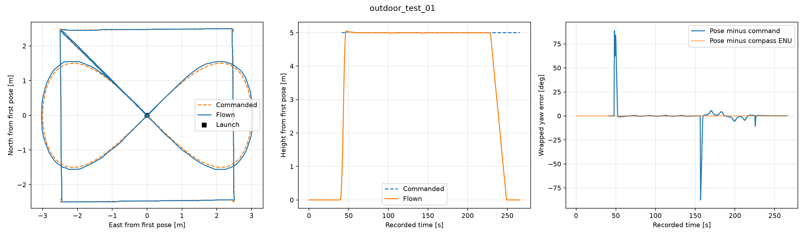

# Overenie riešenia a výsledky

Riešenie bolo overené v ROS 2 Jazzy so simulátorom Gazebo, autopilotom
ArduPilot SITL a MAVROS. Overovanie má tri úrovne: samostatné testy výpočtov,
testy riadiaceho uzla s náhradou MAVROS a celé misie vo fyzikálnej simulácii.
Výsledky letov pochádzajú zo záznamov z 3. a 5. októbra 2026.

## Zostavenie a automatizované testy

| Kontrola | Výsledok a doklad |
|---|---|
| Zostavenie z čerstvého lokálneho Git klonu | Overené 19. 10. 2026 na commite `40aeec1`: zostavenie a inštalácia prešli. [Log zostavenia](results/submission_build.log) |
| Automatizované testy z tohto klonu | `core_tests` a `path_guard_tests`: 2 z 2 prešli. [Log testov](results/submission_tests.log) |
| Zostavenie z čistej kópie zdrojov | Úspešné zostavenie a inštalácia; [log](results/clean_build.log). Išlo o kópiu zdrojov, nie o čerstvý klon z GitHubu. |
| Pomocné výpočty a spracovanie CSV | Testy prešli; zahŕňajú uhly, osmičku, konverziu súradníc a neplatné vstupy. [Výpis testov](results/recovery_checks.log) |
| Nezávislá kontrola úsekov v mape | Testy prešli vrátane regresného prípadu na učiteľskej PCD mape. [Výpis testov](results/recovery_checks.log) |
| Riadiaci uzol s náhradou MAVROS | Všetkých 11 scenárov prešlo. [Úplný výsledok](results/mock_mavros_results.json) |

Testy riadiaceho uzla pokrývajú indoor a outdoor misiu, neplatné GPS,
neplatný kvaternión orientácie, zamietnutie zmeny režimu, aktivácie motorov
a vzletu, prerušenie cez službu, zásah pilota, výpadok spojenia a stratu GPS.
Náhrada MAVROS overuje reakcie programu; nenahrádza fyziku simulátora.
Pomocné testy a kontrola trás boli opätovne spustené 5. októbra.

Kontrola z 19. októbra použila nový lokálny klon odovzdávacieho repozitára
vytvorený príkazom `git clone --no-hardlinks`, samostatné prázdne priečinky
pre zostavenie a inštaláciu a `colcon build` v konfigurácii `Release`.
Nasledoval `colcon test` s návratovým kódom pri zlyhaní testu. Kontrola
prebehla na tom istom počítači; nešlo o nové spustenie simulačných letov.

Podrobné výsledky plánovania A1.1 pre obe misie a dva polomery inflácie sú
v [overení plánovača](a11_validation.md). Obsahujú časy výpočtu, počty bodov
a kontrolu bezpečnosti zjednodušených aj pôvodných trás.

## A1.2 — let v hangári

Misia z `missions/indoor.csv` dokončila všetkých šesť presunov, obidve úlohy
natočenia, medzipristátie s deaktiváciou a opätovnou aktiváciou motorov,
ďalší vzlet a konečné pristátie. Záznam končí stavom `DONE`, režimom `LAND`
a `armed=false`.

| Meraná veličina | Výsledok |
|---|---:|
| RMS chyby polohy počas vykonávania úloh (`TASK`) | 0,040 m |
| Maximálna chyba polohy v `TASK` | 0,065 m |
| RMS chyby natočenia počas navigácie | 0,46° |
| Maximálna chyba natočenia počas navigácie | 1,73° |
| Najväčšia výška voči prvej zaznamenanej polohe | 4,64 m |
| Medián frekvencie posielania cieľov | 25,0 Hz |

Výška počas presunu môže presiahnuť výšku cieľov v CSV: trojrozmerný plánovač
vyberá aj trasu ponad regál. CSV určuje polohy cieľov, nie výškový strop
každého úseku. Dlhšia prestávka medzi cieľovými správami pri `landtakeoff`
zodpovedá pristávaniu a opätovnému vzletu.

Následná kontrola 1 213 vzoriek navigácie a držania polohy v PCD mape našla
pri inflácii **0,35 m nulový počet blokovaných bodov aj spojníc**. Ide o
kontrolu zaznamenanej dráhy, nie iba požadovaných cieľov. Plánovanie používa
infláciu 0,65 m; rovnaký odstup však nebol preukázaný pre celý skutočný let.
Táto kontrola tiež nenahrádza meranie kontaktov v Gazebe.

Doklady: [graf](results/indoor_success.png),
[číselné výsledky](results/indoor_success.json),
[priebeh stavov](results/indoor_mission.log),
[kontrola odstupov](results/recovery_checks.log),
[rosbag](../recordings/indoor_success.tar.gz).

Pri prvom vývojovom teste sa riadenie zastavilo v natočení pre neúplné
spustenie požadovaných tokov telemetrie. Aktuálny štart najprv dokončí
požiadavky na intervaly správ a odmieta neplatnú orientáciu. Úspešný let
obsahuje túto úpravu. [Záznam neúspešného testu](results/indoor_initial_failure.log)
zostáva súčasťou výsledkov.

Pri samostatnom spustení s grafickým Gazebom spôsobilo výrazné spomalenie
simulácie prekročenie 6-sekundového limitu telemetrie a stav `ABORT`.
Pre takýto beh sa v návode používa parameter `telemetry_timeout:=15.0`.
Limit je meraný reálnym časom, aj keď trajektória používa simulačný čas.
Vyšší limit toleruje oneskorenie správ, ale zároveň predlžuje reakciu na
skutočný výpadok. Úspešné opakovanie indoor misie s týmto nastavením bolo
potvrdené obsluhou; samostatný rosbag tohto opakovania nie je priložený.

Alternatívna misia `indoor_alternative.csv` bola overená plánovaním všetkých
úsekov. Jej celý let v simulácii zatiaľ nie je doložený.

## A1.3 — vonkajší let

Všetky štyri priložené outdoor záznamy obsahujú štvorec s natočením na POI,
súvislú osmičku, návrat, pristátie a deaktiváciu motorov. Pri každom je
zaznamenané `DONE` a `armed=false`.

| Beh | Dátum | RMS chyby polohy na osmičke | RMS chyby smeru na osmičke | Rozmer preletenej osmičky |
|---|---|---:|---:|---:|
| [outdoor_run1](results/outdoor_run1.json) | 3. 10. 2026 | 0,0850 m | 2,45° | 6,07 × 3,11 m |
| [outdoor_run2](results/outdoor_run2.json) | 3. 10. 2026 | 0,0856 m | 2,55° | 6,07 × 3,11 m |
| [outdoor_final](results/outdoor_final.json) | 5. 10. 2026 | 0,0843 m | 2,39° | 6,07 × 3,11 m |
| [outdoor_user_01](results/outdoor_user_01.json) | 5. 10. 2026 | 0,0876 m | 2,53° | 6,06 × 3,11 m |

Prvé dva behy boli úspešné za sebou. Beh `outdoor_final` overuje aj úpravy
spoločného štartu a časovania riadenia. Konkrétne zdroje a spustiteľný súbor
identifikuje [manifest kontrolných súčtov](results/outdoor_final_source_manifest.json).

Posledný beh vznikol samostatným spustením podľa návodu s grafickou simuláciou
a nastavením časového limitu na 15 s. Jeho pôvodný názov rosbagu je
`outdoor_test_01`; v tomto balíku sú kópie výsledkov označené `outdoor_user_01`.
Označenie umožňuje odlíšiť opakovanie od predchádzajúcich meraní.

Pri tomto opakovaní bola maximálna chyba polohy na osmičke 0,456 m a
95. percentil 0,098 m. RMS chyby natočenia na POI počas navigácie mimo
1-metrového okolia stredu bol 2,27°. Maximálna výška bola 5,06 m a
vzdialenosť od prvého zaznamenaného bodu 3,50 m. Medián frekvencie cieľových
správ bol 25,0 Hz, najdlhšia medzera 0,0423 s.

Ďalšie doklady: [graf kontrolného letu](results/outdoor_final.png),
[log riadenia](results/outdoor_final_mission.log),
[log MAVROS](results/outdoor_final_mavros.log) a
[zoznam všetkých rosbagov](../recordings/README.md).

Samostatný test služby na prerušenie misie potvrdil požiadavku na `LAND`
a následnú deaktiváciu motorov autopilotom. K dispozícii je
[výpis prerušenia](results/outdoor_abort.log) a
[udalosti autopilota](results/outdoor_autopilot_events.log); tento test
nemá samostatný rosbag.

## Ako interpretovať metriky

Skript [analyze_bag.py](../scripts/analyze_bag.py) porovnáva každú prijatú
polohu s posledným zaznamenaným cieľom. RMS je odmocnina priemeru štvorcov
chyby; 95. percentil znamená, že 95 % vyhodnotených absolútnych chýb bolo
najviac na uvedenej hodnote. Natočenie sa porovnáva po prevedení rozdielu
na interval okolo nuly, aby prechod cez ±180° nevytváral umelú veľkú chybu.

- Výsledok zahŕňa oneskorenie merania a komunikácie. Nie je to meranie
  presnosti samotného regulátora ani kolízií.
- Časy v CSV a dĺžka záznamu vychádzajú z časov prijatia správ do rosbagu.
  Pri pomalej simulácii sa líšia od času trajektórie. Samotná osmička má
  pri `omega=0.2` periódu približne 31,4 s simulačného času.
- Vo fázach `LAND` a `DONE` skript stále porovnáva polohu s posledným
  letovým cieľom. Rast chyby pri klesaní preto nie je chyba pristávania.
- Hodnotenie smeru na POI má význam pre outdoor misiu; pri indoor trase
  sa táto položka spoločného reportu nepoužíva.
- Rozmery osmičky a maximá vychádzajú zo zaznamenaných vzoriek. Hlásenie
  `DONE` dokladá dokončenie postupu, samo osebe nedokazuje odstupy od prekážok.

## Rozsah preukázaného overenia

Zostavenie z čerstvého lokálneho klonu a automatizované testy sú doložené;
uvedené misie boli overené v simulácii. Pred odovzdaním zostáva overiť
spustenie na inom počítači podľa podmienok A1.4. Dokumentácia a záznamy
nenahrádzajú individuálnu obhajobu. Let na fyzickom drone nie je týmito
výsledkami overený.
